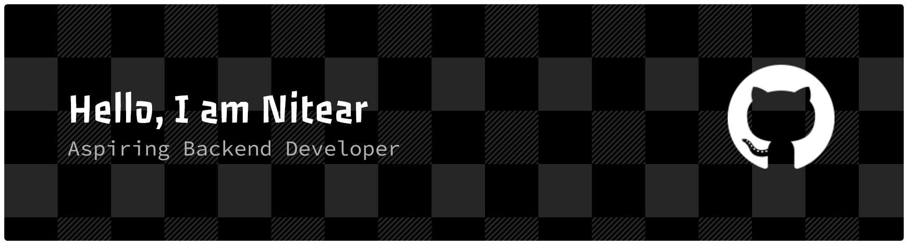

## Hi there 👋 

Hello!👋 My name is **Etel Niño G. Tuñgol**. Computer Science Graduate.
I am very interested in to learn more about backend programming.

Skills:
 
Web and Mobile Development

Tech Stack and Tools:

  
  
  
  
  
  
  
  

Socials:

  
  
  

